# 08 — ContextMuse V2 Architecture Proposal

**Project:** ContextMuse V2 — Controlled Migration & Change-Control System  
**Purpose:** Complete proposed V2 site tree, URL hierarchy, navigation architecture, and case-study routing model that unifies the Four-Room architecture with all preserved products, case studies, research studies, and creative works.

---

## 1. Architectural Principles of ContextMuse V2

1. **One Unified Visual & Navigation System:** Every public page on `www.contextmuse.com` uses the V2 Four-Room navigation shell (`SiteHeader.jsx` / `SiteFooter.jsx` or the lightweight V2 standalone app top-bar for full-screen tools). The legacy `<nav class="navbar">` (`Work / Services / Products / Creative / About / Start a Project -> /contact/`) is retired from all public routes.
2. **Semantic, Crawlable Navigation:** Every room card (`RoomTile.jsx`), header link, footer link, and project card uses semantic `<a href="...">` / `<Link to="...">` elements, and `scripts/build-spa.mjs` pre-renders semantic `<main>` fallback markup into every static HTML route entry so crawlers and non-JS clients receive complete content.
3. **Permanent, Shareable Case Study & Product URLs:** Case studies are promoted from query-only modals (`/work?case=<id>`) to first-class path routes (`/work/<slug>/`) while maintaining 100% backwards compatibility for `?case=<id>` links and 308 redirects from legacy paths.
4. **Single Canonical Intake & Pricing System:** All build inquiries route through `/build/` (`Whiteboard`, `FlowBuilderModal`, and `BriefDrawer` -> `POST /api/lead`), and all commercial pricing references align with `/method/#ways-to-work-together` (`From $2,500`, `From $6,500`, `Custom Scope`, and `$395` Optional Diagnostic).
5. **Honest 4-Tier Project Taxonomy:** Studio output is clearly organized into **Client Systems**, **Commercial Prototypes**, **Independent Products & Utilities**, and **Civic & Creative Systems**.

---

## 2. Proposed V2 Site Tree & URL Hierarchy

```mermaid
flowchart TD
    Root["/ (Homepage — #23282A Editorial Dark + 4-Room Grid)"]
    
    Root --> Work["/work/ (01 The Work — Showcases & Full Content Index)"]
    Root --> Build["/build/ (02 The Builds — Whiteboard, 3 Tracks, FlowBuilder & BriefDrawer)"]
    Root --> Lab["/lab/ (03 The Lab — Interactive Workbench, Products & Creative Systems)"]
    Root --> Method["/method/ (04 The Method — 4-Step Process, Pricing & Founder)"]
    
    Work --> WorkCases["/work/:slug/ (Permanent Case Study Routes)"]
    WorkCases --> CS1["/work/wolf-ridge-dumpsters/ (alias: /work/lone-wolf-dumpsters/)"]
    WorkCases --> CS2["/work/inncontrol-coils/"]
    WorkCases --> CS3["/work/edr-party-rentals/"]
    WorkCases --> CS4["/work/gensort/"]
    WorkCases --> CS5["/work/signal/"]
    WorkCases --> CS6["/work/contest-atlas/"]
    WorkCases --> CS7["/work/revision-atlas/"]
    WorkCases --> CS8["/work/website-audit-system/"]
    WorkCases --> CS9["/work/client-opportunity-engine/"]
    WorkCases --> CS10["/work/self-cartography/"]
    WorkCases --> CS11["/work/maps-with-teeth/"]
    WorkCases --> CS12["/work/how-to-explain-yourself-to-wolves/"]
    WorkCases --> CS13["/work/made-of-reasons/"]
    WorkCases --> CS14["/work/brain-raccoon/"]
    
    Lab --> DI["/lab/design-intelligence/ (Studies 01–03 & 4:3 Visual Measurement)"]
    Lab --> Apps["Standalone Interactive Products & Experiments"]
    Apps --> App1["/cxm_gensort/index.html (GenSort Studio App)"]
    Apps --> App2["/signal/ & /signal/demo/ (Signal Product Suite)"]
    Apps --> App3["/wcsm/ (Contest Atlas Live App)"]
    Apps --> App4["/cartography/ (Self-Cartography V1 App)"]
    Apps --> App5["/website-system-check/ (Live URL Diagnostic Tool)"]
    Apps --> App6["/creative/how-to-explain-yourself-to-wolves/ & /creative/interaction-lab/ & /restaurant-theory/"]
    
    Root --> Global["Global & Utility Routes (V2 Shell)"]
    Global --> Acq["/acquisition/ (IP Licensing & Acquisition Dossier)"]
    Global --> Priv["/privacy/ (Privacy Policy in V2 Shell)"]
    Global --> Terms["/terms/ (Terms of Service in V2 Shell)"]
```

---

## 3. Complete V2 Route Specification Table

### 3.1 Core Four-Room & Research Routes (React SPA + Static Pre-Rendered `<main>`)

| Canonical V2 Route | Component / View | Role in V2 Architecture |
| :--- | :--- | :--- |
| `/` | `src/pages/Home.jsx` | Primary entrance: `#23282A` hero, semantic `<Link>` Four-Room Quadrant (`01 The Work`, `02 The Builds`, `03 The Lab`, `04 The Method`), Featured Proof, and Need Selector. |
| `/work/` | `src/pages/Work.jsx` | Room 01: Flagship interactive showcases (`Wolf Ridge`, `INNcontrol`, `GenSort`, `Signal`), categorized project grid, and filterable `#content-index`. |
| `/work/:slug/` | `src/pages/Work.jsx` + `ProofViewer.jsx` (or dedicated case study view) | Crawlable, pre-rendered canonical path routes for all 14 case studies (plus backwards-compatible `/work?case=<slug>` support). |
| `/build/` | `src/pages/Builds.jsx` | Room 02: Interactive `Whiteboard.jsx`, 3 commercial build tracks, `FlowBuilderModal.jsx`, and `BriefDrawer.jsx` lead intake. |
| `/lab/` | `src/pages/Lab.jsx` | Room 03: Interactive 3-module `Workbench.jsx`, Design Intelligence gateway, live product launchers, and Creative Systems showcase. |
| `/lab/design-intelligence/` | `src/pages/DesignIntelligenceCaseStudy.jsx` | Flagship Design Intelligence research program (Studies 01–03, token calibrations, 4:3 visual measurement plates, and live workbench). |
| `/method/` | `src/pages/Method.jsx` | Room 04: 4-step operating sequence (`Immerse`, `Map`, `Build`, `Refine`), `MethodDetail.jsx` artifact drawer, canonical `Ways to Work Together` pricing (`#ways-to-work-together`), and Founder section (`#founder`). |
| `/acquisition/` | `src/pages/Work.jsx` / `SiteFooter.jsx` Acquisition View | Dedicated route for IP acquisition & licensing inquiries (`GenSort Studio`, `Signal`, `Contest Atlas`). |
| `/privacy/` | V2 Legal Page (`src/pages/Privacy.jsx` or V2 static shell) | Studio Privacy Policy rendered inside the V2 Four-Room header/footer shell. |
| `/terms/` | V2 Legal Page (`src/pages/Terms.jsx` or V2 static shell) | Studio Terms of Service rendered inside the V2 Four-Room header/footer shell. |

### 3.2 Standalone Interactive Applications & Product Sub-Routes (Preserved + V2 Navigation Bar)

| Canonical V2 Route | Application / Asset | Shell Treatment |
| :--- | :--- | :--- |
| `/cxm_gensort/index.html` | **GenSort Studio** (Local-first AI media workstation) | Keep standalone full-viewport workstation shell intact. |
| `/wcsm/` | **Contest Atlas (WCSM)** (Submission & deadline engine) | Keep standalone application shell intact. |
| `/cartography/` | **Self-Cartography V1** (Interactive cognitive mapping app) | Keep standalone application shell intact. |
| `/website-system-check/` | **Website + System Check** (`POST /api/diagnostic` + `POST /api/lead`) | Replace legacy `<nav class="navbar">` and footer with V2 Four-Room header/footer; preserve 100% of diagnostic JS and API calls. |
| `/signal/` | **Signal Product Overview** (`$195 / $595 / $1,250+ / $249/mo`) | Replace legacy `<nav class="navbar">` and footer with V2 Four-Room header/footer. |
| `/signal/demo/` | **Signal Interactive 3-Stage POS Workbench** | Replace legacy `<nav class="navbar">` with V2 header; preserve 100% of CSV parser and 3-stage diagnostic engine. |
| `/signal/intake/` | **Signal Operator Diagnostic Intake** (`POST /api/lead`) | Replace legacy navbar/footer with V2 shell. |
| `/signal/sample-reports/` | **Signal Sample Intelligence Reports** | Replace legacy navbar/footer with V2 shell. |
| `/signal/export-instructions/` | **Signal POS Export Guides** (Toast, Square, Clover, etc.) | Replace legacy navbar/footer with V2 shell. |
| `/creative/how-to-explain-yourself-to-wolves/` | **How to Explain Yourself to Wolves** (Interactive literary work) | Replace legacy `<nav class="navbar">` with minimal V2 return bar (`← The Lab · Context & Muse`). |
| `/creative/interaction-lab/` & `/creative/cellular-scroll-study/` | **Interaction Lab & Cellular Scroll Study** | Replace legacy navbar on `/creative/interaction-lab/` with V2 return bar; keep `/creative/cellular-scroll-study/` canvas header intact. |
| `/restaurant-theory/` | **The Architecture of Hospitality** (Domain essay) | Replace legacy navbar/footer with V2 editorial header/footer. |

### 3.3 Consolidated 308 Redirect Map (`vercel.json` V2 Target State)

| Legacy / Inbound Path(s) | V2 308 Redirect Destination |
| :--- | :--- |
| `/pricing`, `/pricing/`, `/services`, `/services/`, `/work-with-me`, `/work-with-me/` | `/method/#ways-to-work-together` |
| `/about`, `/about/`, `/jayme`, `/jayme/` | `/method/#founder` |
| `/custom`, `/custom/`, `/custom-builds`, `/custom-builds/`, `/custom-tools`, `/custom-tools/`, `/websites`, `/websites/`, `/quick-launch`, `/quick-launch/`, `/services/quote-lead-systems`, `/services/quote-lead-systems/` | `/build/` |
| `/contact`, `/contact/`, `/start`, `/start/` | `/build/?brief=true` |
| `/contact/success`, `/contact/success/` | `/build/` |
| `/audit`, `/audit/` | `/website-system-check/` |
| `/systems`, `/systems/`, `/systems/client-builds`, `/systems/client-builds/`, `/portfolio`, `/portfolio/`, `/jayme/product-experience`, `/jayme/product-experience/` | `/work/` |
| `/proof-of-work`, `/proof-of-work/`, `/index`, `/index/` | `/work/#content-index` |
| `/case-studies/edr-party-rentals`, `/case-studies/edr-party-rentals/` | `/work/edr-party-rentals/` |
| `/creative`, `/creative/` | `/lab/` |
| `/design-intelligence`, `/design-intelligence/` | `/lab/design-intelligence/` |
| `/systems/signal`, `/systems/signal/`, `/signal_restaurant_intelligence`, `/signal_restaurant_intelligence/` | `/signal/` |
| `/demo-restaurant-signal-report.html` | `/signal/sample-reports/` |
| `/creative-practice/how-to-explain-yourself-to-wolves/` | `/creative/how-to-explain-yourself-to-wolves/` |
| `/gensort`, `/gensort/` | `/work/gensort/` |

---

## 4. Shared V2 Design Foundations (`/assets/css/v2-shell.css`) & Standalone Integration Patterns (Task 03)

To eliminate the jarring transition between the V2 Four-Room React architecture and standalone static HTML applications without rewriting working tools or duplicating CSS across files, `/assets/css/v2-shell.css` establishes a single shared stylesheet containing:

1. **Standardized `--cm-v2-*` CSS Custom Properties:**
   - `--cm-v2-bg-dark: #23282A` (Editorial dark header/hero surface)
   - `--cm-v2-bg-footer: #1C2022` (Deep dark footer surface)
   - `--cm-v2-bg-stone: #EDE9E0` (Warm editorial stone canvas)
   - `--cm-v2-bg-surface: #FAF8F5` (Elevated card/panel surface)
   - `--cm-v2-bg-recessed: #E5DFD2` (Recessed table/control header surface)
   - `--cm-v2-room-work: #8A4A36`, `--cm-v2-room-build: #17504A`, `--cm-v2-room-lab: #464366`, `--cm-v2-room-method: #96722E`
   - `--cm-v2-font-display: 'Archivo', 'Plus Jakarta Sans', -apple-system, sans-serif`
   - `--cm-v2-font-sans: 'Plus Jakarta Sans', -apple-system, sans-serif`
   - `--cm-v2-font-mono: 'IBM Plex Mono', 'JetBrains Mono', monospace`
2. **Three Reusable Shell Integration Patterns:**
   - **Pattern A — Full V2 Four-Room Header & Footer + Optional Sub-Navigation Bar (`.cm-v2-header`, `.cm-v2-subbar`, `.cm-v2-footer`, `.cm-v2-tool-surface`):** Used on scrollable diagnostic utilities and multi-page product funnels that previously used `<nav class="navbar">`. Implemented and verified on `/website-system-check/`, `/privacy/`, `/terms/`, and `/404.html` in Task 03; scheduled for `/signal/`, `/signal/intake/`, `/signal/sample-reports/`, and `/signal/export-instructions/` in Task 04.
   - **Pattern B — Compact V2 Product Topbar + V2 Footer (`.cm-v2-product-header`, `.cm-v2-footer`):** Used on dense interactive workbenches with their own secondary sticky control strip (`/signal/demo/`), replacing `<nav class="navbar">` with a compact 48px dark V2 header (`Context & Muse · Signal Demo Workbench` + `← Signal Overview` + `03 The Lab`) to preserve vertical viewport height for the 3-stage CSV parser.
   - **Pattern C — Minimal Return Control / Native Workstation Chrome (`.cm-v2-return-pill`):** Used on full-viewport (`100vh`, `overflow: hidden`) local-first software workstations that already have bespoke dark application chrome and no legacy `.navbar`:
     - `/cxm_gensort/index.html`: Pre-compiled Vite workstation bundle with strict CSP and IndexedDB/File System Access API — left 100% unmodified.
     - `/cartography/index.html`: Already features a 52px dark `.app-topbar` (`Context & Muse · CARTOGRAPHY V1`) — only requires removing dead `<script src="/assets/js/nav.js">` / `whatsapp.js` tags.
     - `/wcsm/index.html`: Already features a dark `.app-header` with 6 internal view tabs — only requires adding a `.cm-v2-return-pill` (`← Context & Muse`) inside `.utility-cluster`.

---

## 5. Complete 6-Category Legacy Route Disposition Summary (Task 03)

Every legacy static HTML route in the repository is classified into one of six disposition categories:

1. **Migrate content into V2 (then redirect):**
   - `/work/lone-wolf-dumpsters/` -> Merge unique technical narrative into `/work/wolf-ridge-dumpsters/` (or `/work/lone-wolf-dumpsters/`), then 308 redirect.
   - `/work/client-opportunity-engine/` -> Add dossier to `src/data/projects.js` and promote to `/work/client-opportunity-engine/`.
   - `/work/contest-atlas/` -> Merge long-form architecture notes into `/work/contest-atlas/` V2 case study view.
   - `/work/revision-atlas/` -> Merge long-form architecture notes into `/work/revision-atlas/` V2 case study view.
   - `/work/website-audit-system/` -> Merge long-form architecture notes into `/work/website-audit-system/` V2 case study view.
   - `/case-studies/edr-party-rentals/` -> Merge full case study into `/work/edr-party-rentals/`, then 308 redirect `/case-studies/edr-party-rentals/` -> `/work/edr-party-rentals/`.
2. **Redirect to an existing V2 destination (no unique content lost):**
   - `/pricing/` -> `/method/#ways-to-work-together` (**Completed in Task 02**)
   - `/services/` -> `/method/#ways-to-work-together`
   - `/services/quote-lead-systems/` -> `/build/`
   - `/custom/` -> `/build/`
   - `/quick-launch/` -> `/build/`
   - `/contact/` -> `/build/?brief=true`
   - `/contact/success/` -> `/build/`
   - `/systems/` and `/systems/client-builds/` -> `/work/`
   - `/proof-of-work/` -> `/work/#content-index`
   - `/creative/` -> `/lab/`
   - `/about/` -> `/method/#founder`
   - `/signal_restaurant_intelligence/` -> `/signal/`
   - `/demo-restaurant-signal-report.html` -> `/signal/sample-reports/`
   - `/creative-practice/how-to-explain-yourself-to-wolves/` -> `/creative/how-to-explain-yourself-to-wolves/`
3. **Preserve as a standalone application (with Pattern A, B, or C V2 integration):**
   - `/website-system-check/` (**Completed in Task 03 — Pattern A**)
   - `/privacy/`, `/terms/`, `/404.html` (**Completed in Task 02/03 — Pattern A**)
   - `/signal/`, `/signal/intake/`, `/signal/sample-reports/`, `/signal/export-instructions/` (Pattern A + Signal Subbar)
   - `/signal/demo/` (Pattern B Compact Product Header)
   - `/cxm_gensort/` (Pattern C — unmodified workstation)
   - `/cartography/` (Pattern C — remove dead `nav.js`/`whatsapp.js` tags)
   - `/wcsm/` (Pattern C — add `.cm-v2-return-pill`)
   - `/creative/how-to-explain-yourself-to-wolves/`, `/creative/self-cartography/`, `/creative/interaction-lab/`, `/creative/cellular-scroll-study/`, `/restaurant-theory/` (Pattern A/C editorial & creative works)
4. **Preserve as an unlisted reference (`noindex`, excluded from production deployment via `.vercelignore`):**
   - `/rudyards-comedy/`, `/sixes-and-sevens/`, `/southern_smoke/`, `/dealsignal/`, `/star-gift/`, `/istar-map/`, `/tiktok-shop-roi-analyzer/`, `/twenty-minute-override/`, `/preview/`
5. **Archive after content preservation:**
   - Shadowed legacy HTML files (`/about/index.html`, `/contact/index.html`, `/custom/index.html`, `/services/index.html`, `/quick-launch/index.html`, `/systems/index.html`, `/proof-of-work/index.html`, `/signal_restaurant_intelligence/index.html`) once their 308 redirects and content migrations are active.
6. **Requires founder decision (`07-OPEN-DECISIONS.md`):**
   - **OD-01:** Retiring legacy `$375 / $600 / $1,000–$2,500 / $2,000` pricing pages in favor of `/method/#ways-to-work-together`
   - **OD-02:** `Wolf Ridge Dumpsters` vs. `Lone Wolf Dumpsters` canonical title and slug
   - **OD-03:** Project classification taxonomy updates in `src/data/contentRegistry.js`
   - **OD-04:** `/inncontrol-v2/` showcase CTA destination vs. "Operator Readiness & Status HUD" label
   - **OD-05:** `/gensort/` consumer SaaS pricing (`$0–$39/mo`) vs. IP acquisition positioning

---

## 6. Project Classification Taxonomy Recommendations (Task 03)

To ensure every project in `src/data/contentRegistry.js` (22 entries) and `src/data/projects.js` (13 entries) is represented accurately without inflating client counts or diminishing independent engineering, we recommend the following 5-tier taxonomy (pending Founder approval of OD-03 before modifying `contentRegistry.js`):

| Taxonomy Category | Recommended `contentType` Token | Assigned Projects | Rationale |
| :--- | :--- | :--- | :--- |
| **1. Client Work** | `'client-work'` | `lone-wolf-dumpsters` (Wolf Ridge / Lone Wolf), `inncontrol-coils` (INNcontrol Commercial HVAC) | Commissioned commercial systems built for external operating businesses. |
| **2. Commercial Prototypes** | `'commercial-prototype'` | `edr-party-rentals` (EDR Interactive Tent & Event Planner), `/inncontrol-v2/` (Guest-Air Hospitality Concept) | High-craft commercial vertical prototypes and concept systems; distinguishes prototypes from commissioned production deployments. |
| **3. Independent Products** | `'independent-product'` | `gensort` (GenSort Studio), `signal` (Signal Restaurant Intelligence), `contest-atlas` (WCSM / Contest Atlas), `self-cartography` (Self-Cartography V1), `revision-atlas` (Revision Atlas), `website-audit-system` (Website + System Check), `client-opportunity-engine` | Original software products, SaaS workbenches, and diagnostic engines engineered and owned by Context & Muse. |
| **4. Research & Experiments** | `'research-experiment'` | `design-intelligence` (Design Intelligence Program + Studies 01–03), `interaction-lab` (Interaction Lab), `cellular-scroll-study` (Cellular Scroll Study), `restaurant-theory` (The Architecture of Hospitality) | Empirical design research, token calibration studies, canvas physics experiments, and domain essays. |
| **5. Civic & Creative Systems** | `'civic-creative-system'` | `maps-with-teeth` (Maps With Teeth — corrected from `'client-project'`), `how-to-explain-yourself-to-wolves`, `made-of-reasons` (MadeOfReasons.com), `brain-raccoon` (BrainRaccoon.com) | Founder-built public-interest investigative mapping (`role: 'Founder'`) and interactive literary/creative publications. |

---

## 7. Security & Prototype Exposure Assessment (Task 03)

| Exposure Dimension | Verified Repository & Deployment State | Risk & Required Action |
| :--- | :--- | :--- |
| **1. Source excluded from future deployments (`.vercelignore` on `release/final-launch-candidate`)** | `.vercelignore` excludes `private/`, `records/`, `evidence/`, `legal/`, `for-sale/`, `brand/`, `ops/`, `docs/`, `scripts/`, `*.map`, and all 9 prototype folders (`dealsignal/`, `star-gift/`, `istar-map/`, `tiktok-shop-roi-analyzer/`, `twenty-minute-override/`, `southern_smoke/`, `sixes-and-sevens/`, `rudyards-comedy/`, `preview/`). | **Protected on next deployment** from `release/final-launch-candidate`. |
| **2. Content still accessible in current `main` production (`b8a9ab5`)** | Inspection of `git ls-tree main` confirms that `main` (`b8a9ab5`) still tracks `rudyards-comedy/`, `sixes-and-sevens/`, `southern_smoke/`, `dealsignal/`, `star-gift/`, `istar-map/`, `tiktok-shop-roi-analyzer/`, `twenty-minute-override/`, `preview/`, and `brand/`. Until `release/final-launch-candidate` is promoted to production, those static folders remain reachable by direct URL on `www.contextmuse.com` (though guarded by `X-Robots-Tag: noindex, nofollow` in `vercel.json`). | **Active Production Exposure until Launch Promotion:** Promoting the candidate branch (with `.vercelignore` and cleaned `robots.txt`) is required to remove these paths from live production serving. |
| **3. Content accessible through preview deployments** | Preview deployments built from `release/final-launch-candidate` respect `.vercelignore`, so the 9 prototype folders and `*.map` source maps are **not** uploaded to new preview deployments. | **Protected in candidate previews.** |
| **4. Sensitive or confidential content inside prototype directories** | Automated credential/PII scan across all 9 prototype directories (`dealsignal/`, `star-gift/`, `istar-map/`, `tiktok-shop-roi-analyzer/`, `twenty-minute-override/`, `southern_smoke/`, `sixes-and-sevens/`, `rudyards-comedy/`, `preview/`) confirmed **zero** API keys, tokens, passwords, or private customer records. However, `southern_smoke/index.html`, `sixes-and-sevens/index.html`, and `rudyards-comedy/index.html` contain named Houston hospitality pitch concepts and external fonts/CDN references. | **No credential leak**, but pitch confidentiality requires keeping `.vercelignore` active and not re-listing these paths in `robots.txt` or `sitemap.xml`. |
| **5. Content that is intentionally public** | The Four Rooms (`/`, `/work/`, `/build/`, `/lab/`, `/method/`), `/lab/design-intelligence/`, `/website-system-check/`, `/signal/*`, `/cxm_gensort/`, `/cartography/`, `/wcsm/`, `/creative/*`, `/restaurant-theory/`, `/privacy/`, and `/terms/`. | **Intentionally public.** |

